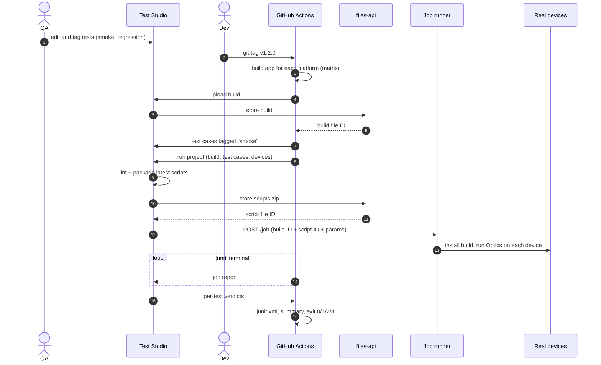

# The journey: test on every build

## Who does what

| Who | Does | Where |
|---|---|---|
| QA engineer | Creates and edits test scripts, tags them `smoke` / `regression` | Test Studio project |
| Developer | Pushes code, tags a release | Their repo |
| GitHub Actions | Builds the app, runs the Mozark Action | CI |
| Mozark | Packages the latest scripts, runs them on real devices, reports | Device cloud |

The repo never holds test scripts. It holds the **project ID**. A script edit in Studio is
picked up by the next build with no repo change.

## Sequence

## What a run leaves behind

- **Job summary** on the run page: verdict, app version, commit, build and script file IDs,
  Mozark job ID, report link, one row per test with its failure class.
- **Artifacts** `mozark-results-<platform>`: `junit.xml`, `summary.md`, `report.json`,
  `tests.json`, `meta.json`.
- **Check annotations** from the JUnit report.
- **Exit code**, so a red Mozark run blocks the release.

## Demo script (5 minutes)

1. Show `mozark.yml`: one project ID, tags per trigger, devices per platform. No tests in the repo.
2. Push tag `v0.1.0` → Actions builds Android, Android TV, webOS and Tizen in parallel.
3. Open one platform's job summary: build ID ↔ version ↔ commit ↔ Mozark job, all green.
4. Run the workflow by hand with scenario `fail`: the run goes red with
   `automation-framework` and the failing test in the summary.
5. Scenario `flaky-infra`: the first job has no free devices, the Action retries once and passes.
6. In Studio, edit a test and push `v0.1.1`: the new run uses the edited script with no repo change.
